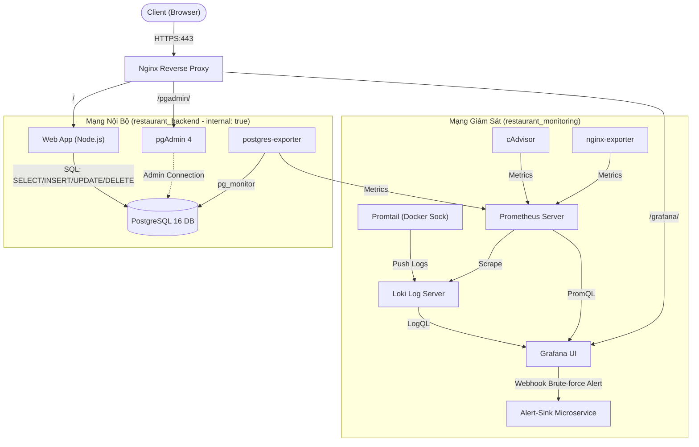

# Hệ Thống Quản Lý Nhà Hàng & Đặt Món Trực Tuyến (Restaurant Order System)
> **Đồ án môn học:** Triển khai và Quản trị Hệ thống Phần mềm (DevOps)  
> **Sinh viên thực hiện:** Trần Danh Đức - **MSSV:** DTC245180050  
> **Kho mã nguồn (Repository):** `https://github.com/imvoka3107/DTC245180050-restaurant-devops.git`

---

## 1. Giới thiệu Đề tài
Dự án **Restaurant Order System** là một hệ thống web đặt bàn, gọi món và quản lý thanh toán nhà hàng hoàn chỉnh theo tiêu chuẩn DevOps production-ready. Hệ thống được đóng gói và vận hành hoàn toàn bằng **Docker Compose** bao gồm đúng **12 microservices** độc lập, khép kín, được bảo vệ bằng các kỹ thuật Security Hardening chuyên sâu:
- **Nginx Reverse Proxy**: Điểm tiếp nhận lưu lượng duy nhất từ bên ngoài (HTTPS tự ký, TLS 1.2/1.3, Rate-limiting chống brute-force, Security Headers).
- **Web App**: Ứng dụng Node.js SSR (Express + EJS + CSS thuần, chạy dưới tài khoản non-root `node:node 1000:1000`).
- **PostgreSQL 16**: Hệ quản trị cơ sở dữ liệu với 7 bảng nghiệp vụ, phân quyền tối thiểu (Least Privilege).
- **pgAdmin 4**: Giao diện trực quan quản trị CSDL, chạy an toàn dưới subpath `/pgadmin/`.
- **Prometheus & Exporters**: Thu thập số liệu giám sát (cAdvisor, Nginx-exporter, Postgres-exporter).
- **Grafana**: Nền tảng trực quan hóa bảng điều khiển Metrics & Logs tập trung, tích hợp hệ thống Cảnh báo tự động (Alerting).
- **Loki & Promtail**: Hạ tầng lưu vết log tập trung, phân tích sự kiện an ninh thông qua LogQL.
- **Alert-Sink**: Microservice tiếp nhận Webhook cảnh báo khi phát hiện tấn công an toàn thông tin.

---

## 2. Sơ đồ Kiến trúc Hệ thống (Architecture Diagram)

```
                    +-------------------------------------------------------+
                    |                   NGƯỜI DÙNG / TRÌNH DUYỆT            |
                    +-------------------------------------------------------+
                                                |
                               HTTPS (Port 443) | HTTP Redirect (Port 80)
                                                v
+---------------------------------------------------------------------------------------------------+
| MÁY CHỦ UBUNTU 24.04 (Host Firewall UFW: Chỉ mở Port 22, 80, 443)                                 |
|                                                                                                   |
|  +---------------------------------------------------------------------------------------------+  |
|  | [restaurant-nginx] Reverse Proxy & SSL Termination & Rate Limiting (10r/m)                  |  |
|  | - Security Headers, server_tokens off, client_max_body_size 3m                              |  |
|  +---------------------------------------------------------------------------------------------+  |
|          | (/)                                | (/pgadmin/)                    | (/grafana/)      |
|          v                                    v                                v                  |
|  +-------------------+              +-------------------+            +-------------------+        |
|  | [restaurant-web]  |              | [restaurant-      |            | [restaurant-      |        |
|  | Node.js SSR       |              |  pgadmin]         |            |  grafana]         |        |
|  | User: node (1000) |              | User: 5050        |            | User: 472         |        |
|  +-------------------+              +-------------------+            +-------------------+        |
|          |                                    |                                ^                  |
|          | (restaurant_backend - INTERNAL)    |                                |                  |
|          +-----------------+------------------+                                | Datasources      |
|                            |                                                   | & Alerts         |
|                            v                                                   |                  |
|          +------------------------------------+              +---------------------------------+  |
|          | [restaurant-db] PostgreSQL 16      |              | [restaurant-prometheus] & Loki  |  |
|          | - postgres_admin (Owner)           |              | - Prometheus (Port 9090 internal) |
|          | - restaurant_app (DML Only)        |<-------------| - Loki (Port 3100 internal)     |  |
|          | - exporter (pg_monitor)            | Exporter     +---------------------------------+  |
|          +------------------------------------+                                ^                  |
|                                                                                | Webhook          |
|  +------------------------------------------------------------------------+    | Alert            |
|  | MẠNG GIÁM SÁT & LOG (restaurant_monitoring)                            |    |                  |
|  | - [cadvisor]: CPU, RAM, Cgroups (read-only)                            |    v                  |
|  | - [promtail]: Thu thập log Docker Sock -> Loki                        | +--------------------+ |
|  | - [nginx-exporter] & [postgres-exporter]                               | | [restaurant-       | |
|  |                                                                        | |  alert-sink]       | |
|  +------------------------------------------------------------------------+ +--------------------+ |
+---------------------------------------------------------------------------------------------------+
```

### Sơ đồ luồng dữ liệu (Mermaid Diagram)



### Cấu trúc Cây Thư mục Dự án (Project Directory Tree)
```text
restaurant/
├── .env.example                     # File mẫu biến môi trường (không chứa bí mật)
├── .gitignore                       # Chặn .env, evidence/, certs/ không lộ lên Git
├── README.md                        # Tài liệu hướng dẫn đồ án chi tiết
├── docker-compose.yml               # Đóng gói và điều phối 12 microservices
│
├── alert-sink/                      # Service tiếp nhận Webhook cảnh báo an toàn
│   ├── Dockerfile
│   ├── package.json
│   └── server.js                    # Webhook listener (ghi log khi có brute-force)
│
├── db/                              # Cơ sở dữ liệu PostgreSQL
│   └── init.sql                     # Khởi tạo 7 bảng, 24 món Á Đông, phân quyền Least Privilege
│
├── docs/                            # Tài liệu báo cáo & phân tích sự cố
│   ├── cho-bao-cao.md               # Đề cương tổng hợp số liệu thực tế nộp bài
│   ├── phien-ban.md                 # Nhật ký phiên bản 3 giai đoạn
│   └── su-co-bruteforce.md          # Phân tích Root Cause Analysis sự cố dò mật khẩu
│
├── grafana/                         # Cấu hình tự động nạp (Provisioning) Grafana
│   └── provisioning/
│       ├── alerting/alerting.yaml   # Cấu hình luật cảnh báo BruteForceLoginSpike
│       ├── dashboards/
│       │   ├── dashboards.yaml
│       │   └── json/                # 4 Dashboards JSON trực quan hóa
│       │       ├── containers.json  # Giám sát tài nguyên CPU/RAM container
│       │       ├── nginx.json       # Giám sát lưu lượng Web & mã lỗi HTTP
│       │       ├── postgres.json    # Giám sát kết nối & truy vấn CSDL
│       │       └── logs.json        # Giám sát Log tập trung theo thời gian thực
│       └── datasources/datasources.yaml # Kết nối sẵn Prometheus & Loki
│
├── loki/                            # Cấu hình máy chủ lưu trữ Log tập trung
│   └── loki-config.yaml
│
├── nginx/                           # Cổng tiếp nhận Reverse Proxy & Bảo mật
│   ├── gen-cert.sh                  # Script tạo chứng chỉ TLS tự ký (SAN IP máy chủ)
│   └── nginx.conf                   # TLS 1.2/1.3, Rate limiting /login, Security Headers
│
├── prometheus/                      # Máy chủ thu thập Metrics chuỗi thời gian
│   └── prometheus.yml               # Scrape cấu hình cAdvisor, Nginx & Postgres Exporter
│
├── promtail/                        # Agent thu thập log Docker daemon
│   └── promtail-config.yaml         # Đọc /var/run/docker.sock, đẩy log về Loki
│
├── scripts/                         # Các kịch bản kiểm thử & tự động hóa
│   ├── simulate_bruteforce.sh       # Mô phỏng tấn công dò mật khẩu tự động
│   └── verify_hardening.sh          # Kiểm thử tự động 11 tiêu chí bảo mật
│
└── web/                             # Ứng dụng Web đặt món & quản lý nhà hàng
    ├── Dockerfile
    ├── package.json
    ├── public/                      # Static assets (CSS thuần, ảnh món ăn Á Đông)
    │   ├── css/style.css            # Giao diện Washi Paper, tone Đỏ Sakura & Trắng kem
    │   └── images/menu/             # 24 vector món ăn & đồ uống Á Đông
    ├── src/
    │   ├── controllers/             # Bộ điều khiển nghiệp vụ phân quyền RBAC
    │   │   ├── authController.js    # Đăng nhập, đăng ký, mã hóa mật khẩu Bcrypt
    │   │   ├── managerController.js # Quản trị Menu, Bàn ăn, Nhân sự, Doanh thu & Excel
    │   │   ├── menuController.js    # Hiển thị thực đơn và giỏ hàng cho khách
    │   │   ├── orderController.js   # Bảng bếp KDS Kanban 3 cột, gộp đơn, VietQR
    │   │   └── reservationController.js # Đặt bàn online và quản lý lịch đặt bàn
    │   ├── middleware/auth.js       # Phân quyền vai trò và CSRF Token
    │   ├── db.js                    # Kết nối CSDL PostgreSQL
    │   └── server.js                # Khởi tạo Express & Session Security
    └── views/                       # Giao diện SSR (EJS)
        ├── index.ejs                # Giao diện đặt món & giỏ hàng
        ├── layout.ejs               # Layout phân quyền Navbar theo vai trò
        ├── manager/                 # Màn hình Quản lý (Dashboard, Menu, Bàn)
        ├── orders/                  # Màn hình Bếp KDS Kanban, Thanh toán & Hóa đơn
        └── reservations/            # Màn hình Đặt bàn
```

---

## 3. Yêu cầu Hệ thống (System Requirements)
- **Hệ điều hành:** Ubuntu 24.04 LTS (hoặc Debian/Ubuntu tương thích).
- **Phần cứng tối thiểu:** 2 CPU Cores, 4 GB RAM, 20 GB dung lượng đĩa trống.
- **Phần mềm bắt buộc:**
  - `Docker Engine` 26.0+ (đã kiểm thử trên Docker 27.2+).
  - `Docker Compose v2` (`docker compose`).
  - `openssl` (để sinh cặp khóa SSL).
  - `curl` và `git`.

---

## 4. Hướng dẫn Triển khai "Chạy bằng Một Lệnh" từ Trạng thái Sạch

### Bước 1: Sao chép mã nguồn (Clone Repository)
```bash
git clone https://github.com/imvoka3107/DTC245180050-restaurant-devops.git ~/restaurant
cd ~/restaurant
```

### Bước 2: Thiết lập Biến môi trường (.env)
Sao chép từ file mẫu `.env.example` và thiết lập mật khẩu mạnh:
```bash
cp .env.example .env
chmod 600 .env
```
*(Bạn có thể chỉnh sửa mật khẩu trong `.env` theo ý muốn, hệ thống sẽ tự động đồng bộ sang database và các dịch vụ).*

### Bước 3: Sinh Chứng chỉ SSL tự ký
Chạy kịch bản tự động tạo khóa RSA 2048-bit và chứng chỉ x509 có SAN:
```bash
chmod +x ./nginx/gen-cert.sh
./nginx/gen-cert.sh
```
Chứng chỉ được tạo tại `nginx/certs/server.crt` và `nginx/certs/server.key` (được bảo vệ qua `.gitignore`, không đưa lên Git).

### Bước 4: Khởi động Toàn bộ Hệ thống
Chạy lệnh khởi tạo duy nhất:
```bash
docker compose up -d --build
```
Kiểm tra trạng thái sẵn sàng (chờ khoảng 30-45 giây để toàn bộ healthcheck đạt `healthy`):
```bash
docker compose ps
```

---

## 5. Bảng Địa chỉ Truy cập & Danh mục Tài khoản Mẫu

| Dịch vụ | Địa chỉ URL | Giao thức | Tài khoản mẫu | Mật khẩu |
|---|---|---|---|---|
| **Website Nhà Hàng** | `https://<VM_IP>/` | HTTPS | Khách hàng: `khach01`<br>Nhân viên: `nhanvien01`<br>Quản lý: `admin` | *Xem trong file `.env`*<br>(Mặc định seed xem `.env.example`) |
| **Quản trị CSDL (pgAdmin)** | `https://<VM_IP>/pgadmin/` | HTTPS | `admin@restaurant.local` | *Xem `PGADMIN_DEFAULT_PASSWORD` trong `.env`* |
| **Giám sát & Logs (Grafana)**| `https://<VM_IP>/grafana/` | HTTPS | `admin` | *Xem `GRAFANA_ADMIN_PASSWORD` trong `.env`* |
| **Cổng HTTP chuyển hướng** | `http://<VM_IP>/` | HTTP -> HTTPS | - | Tự động redirect 301 sang HTTPS |

*(Lưu ý: Thay thế `<VM_IP>` bằng địa chỉ IP của máy ảo, ví dụ `192.168.1.15`).*

---

## 6. Hướng dẫn Sử dụng Ứng dụng theo Vai trò (RBAC)

1. **Khách hàng (`customer` - user: `khach01`)**:
   - Truy cập trang chủ `/` để xem danh sách món ăn, lọc theo danh mục (Khai vị, Món chính, Tráng miệng, Nước uống).
   - Chọn **"Đặt bàn"** (`/reservations/new`): Chọn số lượng khách, chọn bàn ăn và thời gian đặt.
   - Xem lịch sử đặt bàn của cá nhân tại `/reservations` và có quyền hủy lịch đặt nếu chưa xác nhận.
2. **Nhân viên phục vụ / Thu ngân (`staff` - user: `nhanvien01`)**:
   - Xem danh sách và xác nhận đặt bàn của khách.
   - Chọn **"+ Tạo đơn"** (`/orders/new`): Chọn bàn ăn phục vụ và chọn số lượng từng món ăn.
   - Quản lý trạng thái đơn hàng (`pending` -> `preparing` -> `served`).
   - Thực hiện thanh toán hóa đơn (`/orders/:id/checkout`): Chấp nhận tiền mặt, thẻ hoặc mã QR; hệ thống tự động xuất hóa đơn hoàn chỉnh (`/orders/:id/invoice`) và giải phóng bàn ăn.
3. **Quản lý (`manager` - user: `admin`)**:
   - Sở hữu toàn bộ chức năng của nhân viên.
   - Xem **"KPI Doanh thu"** (`/manager/dashboard`): Thống kê doanh thu theo ngày, số đơn hàng hoàn thành, tỷ lệ lấp đầy bàn ăn.
   - **Quản lý Món ăn (`/manager/menu`)**: Thêm món ăn mới kèm tính năng **Tải ảnh minh họa** (hỗ trợ file PNG, JPG, WEBP tối đa 2 MB).
   - Quản lý danh mục, bàn ăn và nhân viên (khóa/mở khóa tài khoản nhân viên).

---

## 7. Giám sát Hiệu năng & Truy vấn LogQL trên Grafana

### Các Bảng Điều Khiển (Dashboards) Tự Động Tích Hợp (Provisioned)
Truy cập `https://<VM_IP>/grafana/` -> Menu **Dashboards** -> Thư mục **Restaurant Monitoring**:
1. **`Restaurant - Containers`**: Đo lường % CPU, RAM sử dụng, Lưu lượng mạng I/O chi tiết theo từng container thông qua cAdvisor.
2. **`Restaurant - Nginx`**: Giám sát Active connections, Requests/giây, Phân tích trạng thái kết nối Nginx.
3. **`Restaurant - PostgreSQL`**: Giám sát số kết nối DB hiện tại, Transactions/giây (Commit/Rollback), Cache hit ratio, Kích thước database.
4. **`Restaurant - Logs`**: Theo dõi dòng log tập trung từ Loki, panel biểu đồ đếm lỗi `LOGIN_FAILED`, biểu đồ tròn phân bố mã phản hồi HTTP của Nginx.

### Hướng dẫn chạy 4 Truy vấn LogQL Mẫu (Grafana Explore hoặc Loki API)
Truy cập **Grafana -> Explore** (Chọn Datasource `Loki`):
- **Q1 (Phát hiện lỗi máy chủ Nginx 5xx):**
  ```logql
  {job="nginx"} |~ " 5[0-9]{2} "
  ```
- **Q2 (Lọc lỗi và ngoại lệ của Web Application):**
  ```logql
  {job="webapp"} |~ "(?i)(error|exception|failed)"
  ```
- **Q3 (Truy vết sự kiện đăng nhập thất bại):**
  ```logql
  {job="webapp"} |= "LOGIN_FAILED"
  ```
- **Q4 (Biểu đồ tần suất đăng nhập thất bại theo thời gian):**
  ```logql
  sum(count_over_time({job="webapp"} |= "LOGIN_FAILED" [1m]))
  ```

---

## 8. Kịch bản Mô phỏng Sự cố An toàn Thông tin (Brute-Force Attack) & Cảnh báo

Hệ thống được trang bị kịch bản phát hiện và ngăn chặn tấn công dò mật khẩu tự động:

### Bước 1: Kích hoạt kịch bản tấn công
Chạy script mô phỏng gửi liên tiếp 20 request đăng nhập sai mật khẩu vào tài khoản quản trị:
```bash
./scripts/simulate_bruteforce.sh
```

### Bước 2: Quan sát cơ chế Phòng thủ & Cảnh báo
1. **Ngăn chặn tức thời (Rate Limiting tại Nginx)**:
   - Các request vượt ngưỡng `10r/m burst=5 nodelay` ngay lập tức bị Nginx từ chối với mã **`HTTP 429 Too Many Requests`**.
2. **Kích hoạt Cảnh báo (Grafana Alerting)**:
   - Alert Rule `Restaurant - Brute force login` định kỳ quét Loki:
     `sum(count_over_time({job="webapp"} |= "LOGIN_FAILED" [1m])) > 5`
   - Khi phát hiện > 5 lỗi trong 1 phút, Alert chuyển từ trạng thái `Normal` sang `Firing`.
3. **Tiếp nhận Webhook Sự cố (Alert-Sink Microservice)**:
   - Grafana tự động bắn Webhook POST tới `http://alert-sink:8080/webhook`.
   - Kiểm tra log cảnh báo an ninh đã được ghi nhận:
     ```bash
     docker compose logs --tail=20 alert-sink
     ```

---

## 9. Danh mục Các Biện pháp Hardening Bảo mật Đã Áp Dụng

1. **Non-root Containers**: Toàn bộ ứng dụng và daemon chính chạy dưới người dùng phi đặc quyền (`node` 1000:1000, `postgres` 70:70, `nobody` 65534, `grafana` 472, `loki` 10001). CAdvisor và Promtail dùng root có giải trình hợp lệ (đọc raw cgroups và docker.sock) kèm chế độ mount `:ro` (chỉ đọc).
2. **Network Isolation**: 3 mạng Docker bridge riêng biệt. Mạng `restaurant_backend` cấu hình `internal: true`, hoàn toàn ngắt kết nối Internet ngoài và không nối trực tiếp với Nginx.
3. **Database Least Privilege**: CSDL phân tách `postgres_admin` (sở hữu schema) và `restaurant_app` (chỉ có quyền DML `SELECT/INSERT/UPDATE/DELETE`, không có quyền `CREATE` hay `DROP TABLE`).
4. **Container Privilege Dropping**: Áp dụng `cap_drop: [ALL]`, `security_opt: [no-new-privileges:true]`, và hệ thống tệp chỉ đọc `read_only: true` cho `web`, `nginx`, `alert-sink`.
5. **Host Firewall (UFW)**: Máy chủ kích hoạt `ufw` với chính sách mặc định chặn toàn bộ kết nối đến (`default deny incoming`), chỉ mở duy nhất 3 cổng TCP: `22` (SSH), `80` (HTTP), `443` (HTTPS).
6. **Bảo vệ CSRF & Cookie**: Ứng dụng tích hợp CSRF token cho toàn bộ form POST; Session Cookie cấu hình `HttpOnly; Secure; SameSite=Strict`.
7. **Quản lý Bí mật**: Phân quyền file `.env` ở mức `chmod 600`, không commit file bí mật vào kho mã nguồn Git.

---

## 10. Hướng dẫn Dừng & Xóa Hệ thống (Tear Down)

- **Dừng hệ thống (Giữ nguyên dữ liệu CSDL và Volumes):**
  ```bash
  docker compose down
  ```
- **Dừng và xóa toàn bộ dữ liệu (Khôi phục trạng thái hoàn toàn mới):**
  ```bash
  docker compose down -v
  ```

---

## 11. Hướng dẫn Xử lý Sự cố Thường gặp (Troubleshooting)

1. **Lỗi `502 Bad Gateway` khi vừa khởi động:**
   - *Nguyên nhân:* PostgreSQL, pgAdmin hoặc Grafana đang trong quá trình chạy migration ban đầu.
   - *Khắc phục:* Chờ khoảng 30-45 giây để container hoàn tất entrypoint và đạt trạng thái `healthy`.
2. **Lỗi cấp quyền tải ảnh `EACCES: permission denied, open uploads/...`:**
   - *Nguyên nhân:* Phân vùng volume `web_uploads` được tạo trước khi chuyển sang non-root user.
   - *Khắc phục:* Chạy lệnh gán quyền cho UID 1000:
     ```bash
     docker run --rm -v restaurant_web_uploads:/data nginx:1.27.1-alpine chown -R 1000:1000 /data
     ```
3. **Trình duyệt cảnh báo chứng chỉ SSL (`Your connection is not private`):**
   - *Nguyên nhân:* Chứng chỉ SSL được ký nội bộ (Self-signed) cho IP máy ảo.
   - *Khắc phục:* Chọn "Advanced" (Nâng cao) -> "Proceed to <VM_IP>" (Tiếp tục truy cập).
